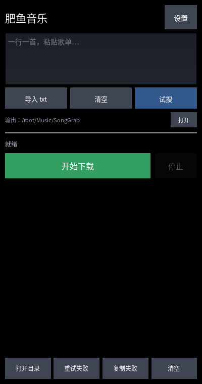
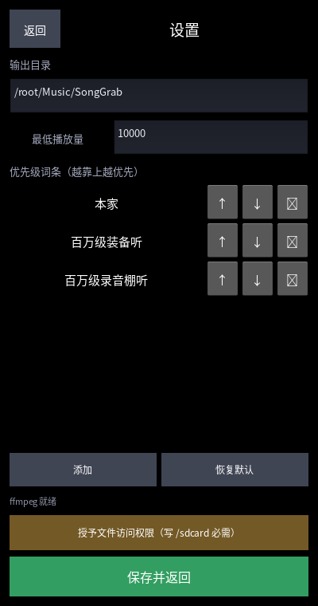

# 肥鱼音乐 SongGrab（Kivy / Android）

| 主界面 | 设置 |
|---|---|
|  |  |


把 B 站歌单批量下载成带标签的 m4a。Android 原生界面（Kivy），由 GitHub Actions
用 buildozer 打包成 APK——**不需要本机有 Android SDK**。

## 目录

```
main.py             Kivy 入口：界面、事件泵、权限
songgrab.kv         全部布局（声明式）
src/songgrab_core.py   业务核心（搜索/选片/下载/台账），仅打了平台补丁
src/platform_compat.py 平台差异：路径、ffmpeg、打开目录、cookie
src/controller.py      编排层：线程 + 事件队列，不依赖 UI 框架
libs/arm64-v8a/libffmpeg.so  静态 ffmpeg（伪装成 .so 以获得 exec 权限）
buildozer.spec      打包配置
.github/workflows/build.yml  CI 构建 APK
```

## 与 Windows 原版的差异

| 项 | 原版 | 这里 |
|---|---|---|
| 界面 | tkinter | Kivy（触摸友好） |
| ffmpeg | 外部 ffmpeg.exe | **内置**：15MB 静态 aarch64 二进制，随 APK 分发 |
| cookie | Edge 浏览器登录态 | 可选 `cookies.txt`（手机无浏览器 cookie 解密） |
| 输出目录 | 桌面 | `/sdcard/Music/SongGrab` |
| 打开目录 | explorer | Android Intent → 文件管理器 |
| 配置位置 | exe 同级 | 应用私有目录 |

## 构建

推送到 GitHub 的 `main` 分支即自动构建：

```bash
git add -A && git commit -m "feat: android port" && git push
```

在仓库 **Actions → Build APK** 页面等约 20–40 分钟（首次编译 Python+SDL2 慢），
构建完成后在 Artifacts 下载 `songgrab-apk`。

也可手动触发：Actions → Build APK → Run workflow。

## 安装后必做

1. 首次启动会请求存储权限，**全部允许**
2. 打开「设置 → 授予文件访问权限（写 /sdcard 必需）」→ 在系统页面开启「所有文件访问」
   （Android 11+ 不开启就写不进 Music 目录）
3. 回主界面粘贴歌单 → 开始下载

## ffmpeg 是怎么进去的（关键）

Android 10+ 的 SELinux **禁止从 app 私有目录 exec 二进制**（`files/bin/ffmpeg` 会 EACCES），
唯一允许执行的目录是 `nativeLibraryDir`（即 APK 里的 `lib/arm64-v8a/`）。

所以做法是：

1. 静态 aarch64 ffmpeg 改名为 `libs/arm64-v8a/libffmpeg.so`
2. `buildozer.spec` 里 `android.add_libs_arm64_v8a = libs/arm64-v8a/*.so`
3. 运行时用 `getApplicationInfo().nativeLibraryDir` 定位它，直接 exec
4. 取不到就降级为「直接落地 + mutagen 写标签」，**保证下载不失败**

来源：[hzw1199/Android-FFmpeg-Prebuilt](https://github.com/hzw1199/Android-FFmpeg-Prebuilt)
（FFmpeg 9.0，LGPL-2.1，静态链接，minSdk 28）。

> 若某些构建产物的 `nativeLibraryDir` 里没有该文件，通常是 manifest 的
> `android:extractNativeLibs` 被设成了 `false`，需要改回 `true`。

## 已知风险

- **`extractNativeLibs`**：若 APK 装完后 ffmpeg 报「无法执行」，检查此项（见上）
- `yt-dlp` 依赖 `pycryptodomex` / `brotli` 等 C 扩展，p4a 交叉编译可能需要试错
- `minapi = 28`（Android 9+），因为预编译 ffmpeg 要求
- 首次构建失败时看 Actions 里 `build-log` artifact
- `MANAGE_EXTERNAL_STORAGE` 只适合自用；上架 Google Play 会被拒
